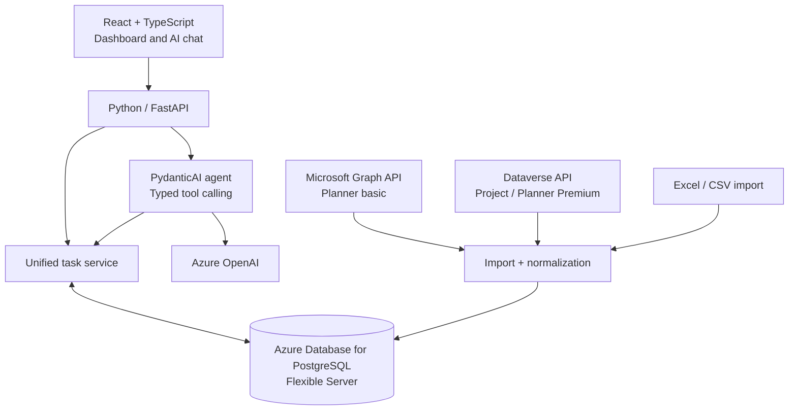

# Azure ProjectOS

**An AI-powered project hub for Microsoft 365** — unifying Microsoft Planner, Microsoft Project, and Excel into a centralized workspace for tracking tasks, deadlines, and team progress. Built with Azure OpenAI and Microsoft Graph APIs, ProjectOS provides interactive Gantt charts, calendars, deliverable views, and resource filters to visualize project timelines and workloads. A natural-language assistant enables teams to query project data, identify bottlenecks, and generate actionable status summaries without switching between tools.

## Disclosure

ProjectOS originated as an internal Microsoft × Bond hackathon project. The original source code and company data are proprietary and are not included in this repository. Architecture and implementation details presented here describe a public-facing reference design and may differ from the internal implementation; any public demo uses independently written code and sample data. No confidential company assets are shared.

## The Problem

Project plans and action items often live in separate tools. Team members must move between Planner boards, Project schedules, and Excel trackers just to answer simple questions:

- What is overdue?
- Who owns the next deliverable?
- How is a project progressing?
- What does the team's workload look like this week?

**ProjectOS** aims to answer these questions from a single workspace.

## Product experience

| Feature | What it enables |
| --- | --- |
| **Unified task view** | Browse work originating from Planner, Project, and Excel in one list. |
| **Gantt timeline** | Visualize schedules, deadlines, and milestones. |
| **Calendar view** | See upcoming work by date. |
| **Owner and project filters** | Narrow down tasks by person, project, or status. |
| **Natural-language assistant** | Ask questions such as “Which deliverables are overdue this week?” |
| **Exports** | Download filtered tasks for status updates and reporting. |

### Example workflow

1. Open ProjectOS to see a consolidated view of active work.
2. Filter tasks to a project or team member, or switch to the Gantt/calendar view.
3. Ask the assistant **“What is overdue, and who owns it?”**
4. Review the matching tasks and export the result.

## Architecture

ProjectOS uses a React frontend, a FastAPI backend, source-specific Microsoft connectors, a PostgreSQL-backed normalized task store, and Azure OpenAI with PydanticAI for typed, read-only task queries.

**Integration note:** Planner basic tasks can be read through **Microsoft Graph**. Former Project for the web / Planner Premium data generally follows a **Dataverse** integration path, while other Microsoft Project products may need different connectors or file imports. Synchronization can use manual refresh or polling; not all three tools support real-time Graph task webhooks.

For component responsibilities, data schema, synchronization flows, and API endpoints, see **[docs/architecture.md](docs/architecture.md)**.

## Tech stack

| Layer | Technologies |
| --- | --- |
| **Frontend** | React, TypeScript |
| **Backend** | Python, FastAPI |
| **Microsoft integrations** | Microsoft Graph API, Dataverse API, Excel / CSV imports |
| **AI orchestration** | PydanticAI (typed tools and structured outputs) |
| **Language model** | Azure OpenAI |
| **Data storage** | Azure Database for PostgreSQL (Flexible Server) |
| **ORM / migrations** | SQLAlchemy, Alembic |