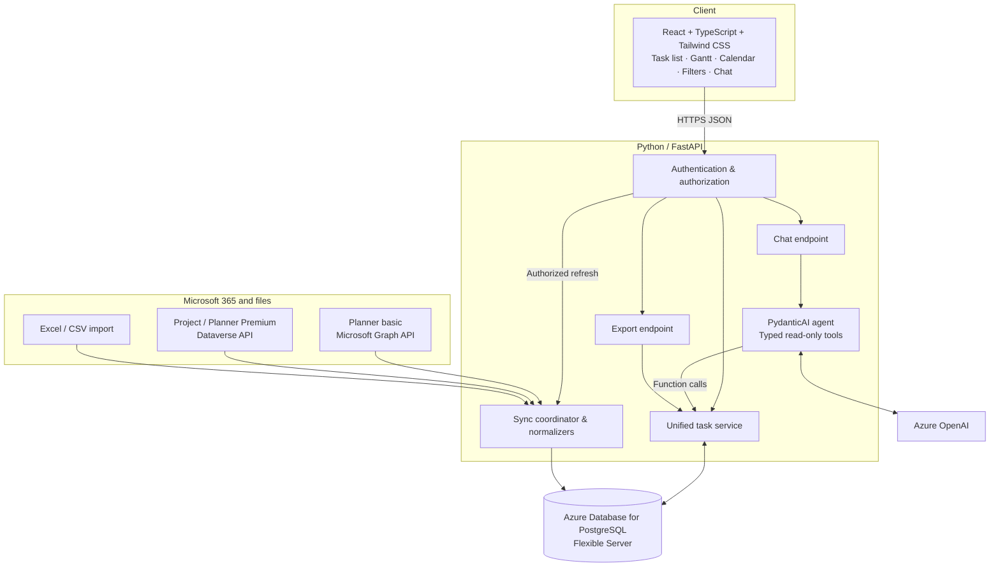
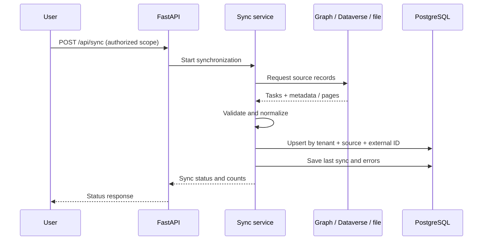
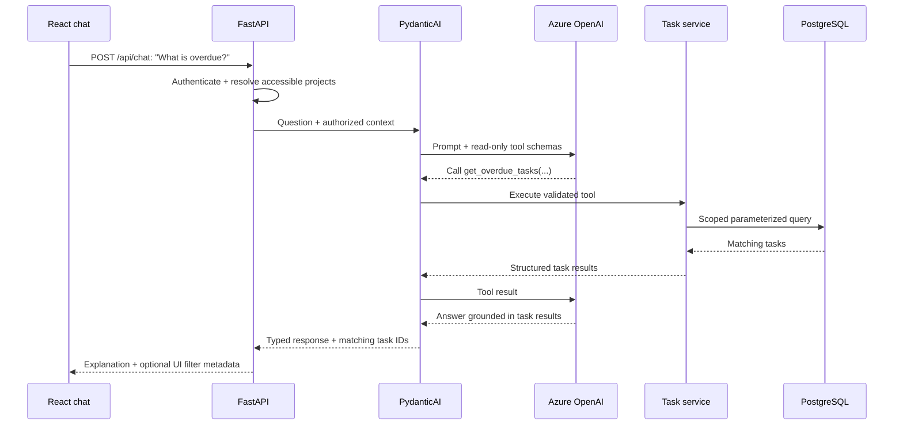

# ProjectOS — System Architecture

> **Document scope:** Public reference architecture aligned with the [ProjectOS README](../README.md). This describes how the system can be built and is not a claim that every component or deployment detail was part of the proprietary hackathon implementation.

## 1. Overview

ProjectOS consolidates project and task information from **Microsoft Planner (basic plans)**, **Microsoft Project / Planner Premium**, and **Excel or CSV trackers** into a single workspace. The frontend presents a task list, Gantt timeline, calendar, filters, and exports. An AI assistant uses **Azure OpenAI via PydanticAI** to answer questions using **typed, read-only tools** backed by the same normalized project data.

The central design choice is **one canonical data model**, with a separate adapter for each upstream source. Neither the dashboard nor the AI agent needs to understand source-specific APIs.

## 2. High-level architecture



**Trust boundaries:** The browser calls FastAPI, not Microsoft source APIs or the database directly. Access tokens and Azure OpenAI credentials remain server-side. Every task query and AI tool call is scoped to the authenticated user's permitted projects.

## 3. Components and responsibilities

| Component | Responsibility | Technology |
| --- | --- | --- |
| Web application | Task table, timeline, calendar, filters, chat UI, CSV download | React, TypeScript, Tailwind CSS |
| HTTP API | Validation, auth, response shaping, orchestration | Python, FastAPI |
| Source adapters | Fetch and map source-specific tasks and metadata | Microsoft Graph, Dataverse, file import |
| Sync coordinator | Run imports, track cursors/checkpoints and errors, upsert canonical records | FastAPI service/background job |
| Unified task service | Project-scoped filtering, aggregation, overdue logic and summaries | SQLAlchemy |
| AI assistant | Choose allowed tools, validate structured results, explain findings | PydanticAI, Azure OpenAI |
| Primary store | Persist normalized projects, tasks, assignments and sync state | Azure Database for PostgreSQL |
| Schema migrations | Version database changes | Alembic |

For an initial demonstration, source imports can be triggered manually; a scheduled worker can be added for periodic refresh without changing the data model.

## 4. Microsoft data ingestion

### 4.1 Planner basic — Microsoft Graph

1. Obtain an appropriately scoped Microsoft Entra ID access token.
2. Identify the plans the signed-in user can access.
3. For each permitted plan, retrieve tasks using a supported Graph endpoint (for example `GET /planner/plans/{plan-id}/tasks`).
4. Resolve owner IDs and relevant plan/project context as permitted.
5. Normalize each task, then upsert it into PostgreSQL.

Preserve Graph task IDs as **external identifiers** rather than treating them as global primary keys. Support pagination, throttling and permission failures.

### 4.2 Project / Planner Premium — Dataverse

Former Project for the web / Planner Premium data generally uses **Dataverse** rather than the standard Planner basic task endpoints. A Dataverse adapter reads the appropriate project, task and assignment tables for an authorized environment, maps them into the canonical schema, and upserts the results. Actual tables, relationships and availability depend on the organization's Project product, licensing and security configuration.

Other Microsoft Project variants, including Project Online or desktop-authored schedules, **may require another connector or an export**. Do not label these as covered by a generic Graph integration.

### 4.3 Excel and CSV

An import endpoint accepts an approved Excel or CSV file and maps columns such as `Task`, `Project`, `Owner`, `Start`, `Due`, `Status` and `Progress` into the same record format. The importer validates dates, handles missing fields and returns row-level errors. File uploads must be checked for file type, size and authorization; no arbitrary spreadsheet formulas are executed.

### 4.4 Import sequence



Imports should be **idempotent**. Deleted or inaccessible source records should be handled using a defined reconciliation policy, not silently removed on a single failed fetch.

## 5. Canonical data model

A minimal normalized task can be represented as:

```typescript
export type TaskSource = "planner" | "project" | "excel";

export interface ProjectTask {
  id: string;                    // Internal UUID
  tenantId: string;              // Security boundary
  source: TaskSource;
  externalId: string;            // Unique within source + tenant
  projectId: string;
  title: string;
  status: "todo" | "in_progress" | "done";
  startDate: string | null;      // ISO 8601
  dueDate: string | null;        // ISO 8601
  progress: number;              // 0..100
  assigneeIds: string[];
  lastSyncedAt: string | null;
}
```

**Recommended relational tables:**

- `projects` — internal ID, tenant ID, source reference and display name.
- `tasks` — internal ID, project ID, source/external IDs, schedule, status, progress and source metadata (`JSONB`).
- `users` — directory identity and display information needed for filtering.
- `task_assignees` — many-to-many task-to-user relationships.
- `task_dependencies` — optional Gantt predecessor relationships where available.
- `sync_runs` — source, start/end time, status, counts and non-sensitive errors.

Enforce a unique constraint on `(tenant_id, source, external_id)`, along with indexes for `(tenant_id, project_id)`, due dates, status and assignee joins. Excel imports need a stable import namespace and row identifier strategy to prevent duplicate uploads.

## 6. API contract

Illustrative endpoints (not a claim that all existed in the original build):

| Method | Endpoint | Purpose |
| --- | --- | --- |
| `GET` | `/api/projects` | List projects visible to the user |
| `GET` | `/api/tasks` | Filter tasks by project, owner, status and dates |
| `GET` | `/api/tasks/{id}` | Get a permitted task's detail |
| `POST` | `/api/sync` | Trigger an authorized import or refresh |
| `GET` | `/api/sync/{run_id}` | Read progress, results and errors |
| `POST` | `/api/imports` | Upload Excel / CSV source data |
| `POST` | `/api/chat` | Ask an AI question about authorized task data |
| `GET` | `/api/export` | Export currently permitted, filtered tasks as CSV |

Use pagination for task lists and bounded result sizes for chat tools and exports. Keep authentication, project scoping, and input validation centralized in the API and service layer.

## 7. Natural-language question workflow

PydanticAI orchestrates Azure OpenAI function/tool calling. The agent receives a set of **typed, read-only operations**, for example:

- `get_overdue_tasks(project_id?, start_date?, end_date?)`
- `get_tasks_by_assignee(assignee_id, project_id?)`
- `get_project_summary(project_id)`
- `get_resource_workload(project_id?, date_range?)`

Tools call the existing unified task service, which applies permission filters before querying PostgreSQL. The model does **not** receive raw database credentials, execute arbitrary SQL, or modify upstream Microsoft data.



For UI actions such as **“show Sarah’s tasks”**, the response may include an explicit, validated filter payload instead of letting the model manipulate the browser directly. Clearly differentiate computed indicators (e.g. overdue) from model-generated interpretation (e.g. project at risk).

## 8. Synchronization strategy

**Default:** Explicit refresh and/or scheduled polling of supported sources. Store `last_synced_at` per source and expose freshness in the UI. This is easier to debug and does not falsely imply that every Microsoft product supports task-level Graph webhooks.

**Optional extensions:** Where a particular resource and tenant permit supported change notifications or Dataverse event workflows, use them to *trigger a refresh*; still reconcile periodically. UI refresh can use polling initially, with server-sent events (SSE) as a later optimization.

## 9. Security, reliability and observability

- Authenticate with Microsoft Entra ID and validate access tokens at the backend; authorize each project and tenant boundary.
- Keep Microsoft and Azure credentials outside frontend bundles; store secrets in an appropriate secret store or managed identity configuration.
- Restrict PydanticAI to allowlisted read-only tools and enforce row-level filtering in the service layer.
- Use parameterized SQL via SQLAlchemy and Alembic-managed migrations.
- Apply retry/backoff for transient API failures and rate limits; record sync status without logging sensitive task content or tokens.
- Expose request latency, import counts, sync failures, and AI tool-call errors for debugging.
- Sanitize CSV exports for spreadsheet formula injection where untrusted values could begin with formula characters.

## 10. Local development and deployment

A practical setup runs React and FastAPI locally with PostgreSQL in Docker. Use sample source adapters to develop independently of company Microsoft tenant access. For a deployed reference implementation, host the application services on a suitable Azure compute product and use Azure Database for PostgreSQL Flexible Server for storage.

Deployment services, permissions and environments are intentionally left adaptable; this document does not assert a specific internal Bond deployment configuration.

## 11. Constraints and boundaries

- The unified model cannot invent upstream properties absent from a source (e.g. dependency edges or progress estimates).
- Cross-source duplicate *business tasks* may be ambiguous even when `(source, external_id)` uniquely identifies source records; semantic deduplication requires an explicit mapping strategy.
- Synchronization is **eventual**, not guaranteed real-time.
- AI answers depend on stored data freshness and the user's permitted scope.
- This public reference design uses read-only AI queries; task edits and bidirectional synchronization are out of scope.

For rationale behind these choices, see [technical-decisions.md](technical-decisions.md).
